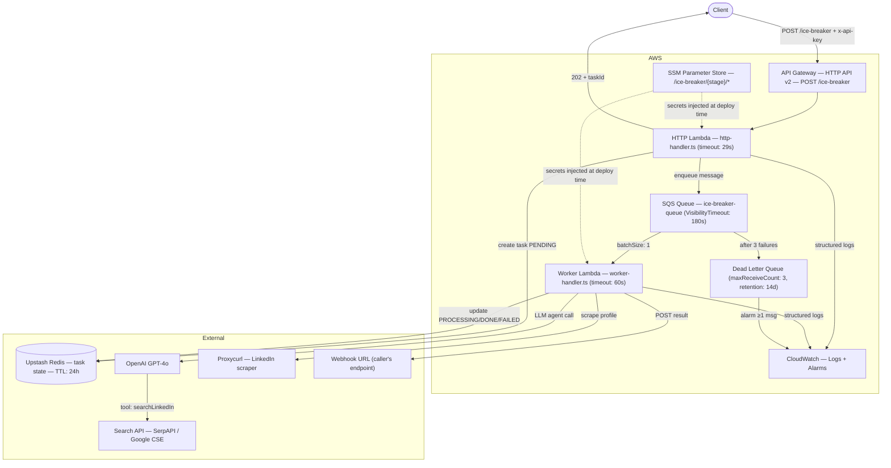
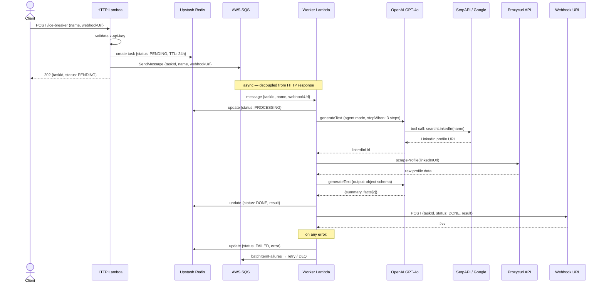

# ice-breaker-ts

Serverless service that receives a person's name, finds their LinkedIn profile via an LLM agent, scrapes it, and generates a short professional summary + two interesting facts — delivered asynchronously via webhook.

## Architecture

Follows a **hexagonal (ports & adapters)** structure: `src/features/` holds domain types and use-cases; `src/adapters/` contains external-service implementations; `src/handlers/` has the Lambda entrypoints and the composition root (`container.ts`).

### Component overview



### Request flow



## Stack

| Concern           | Technology                                                  |
| ----------------- | ----------------------------------------------------------- |
| Runtime           | Node.js 22 + TypeScript 5.8                                 |
| Infrastructure    | Serverless Framework v4 + AWS Lambda                        |
| LLM inference     | Vercel AI SDK (`ai` + `@ai-sdk/openai`)                     |
| LLM model         | GPT-4o (configurable via `LLM_MODEL` env var)               |
| LinkedIn search   | SerpAPI or Google Custom Search (port + adapters)           |
| LinkedIn scraping | Proxycurl API                                               |
| Task persistence  | Upstash Redis HTTP client, TTL 24h                          |
| Queue             | AWS SQS + DLQ (maxReceiveCount: 3, VisibilityTimeout: 180s) |
| Auth              | `x-api-key` header                                          |
| Observability     | pino structured logs → CloudWatch (7-day retention)         |
| Bundling          | esbuild built-in (Serverless Framework v4 `build` key)      |
| Package manager   | pnpm                                                        |

## Project structure

```
src/
  handlers/
    http-handler.ts           # POST /ice-breaker — validates key, enqueues job
    worker-handler.ts         # SQS consumer (batchSize: 1, ReportBatchItemFailures)
    container.ts              # Composition root — builds all adapters and use-cases once
  features/
    domain.ts                 # Task, TaskStatus, TaskResult types
    search-gateway.ts         # SearchGateway port (interface)
    dispatch-task.feature.ts  # Create task in Redis + enqueue SQS message
    process-task.feature.ts   # Run pipeline, update task state, POST webhook
    research-profile.feature.ts  # LLM pipeline: find URL → scrape → summarize
  adapters/
    search/
      serpapi.adapter.ts
      google.adapter.ts
      search.factory.ts       # Selects adapter via SEARCH_PROVIDER env var
    linkedin/
      proxycurl.adapter.ts
    store/
      task-store.ts           # Upstash Redis-backed task store
  shared/
    config.ts                 # Zod-validated env vars, parsed once at module load
    logger.ts                 # pino logger
    auth.ts                   # x-api-key validation
scripts/
  setup-ssm.sh                # Bootstraps SSM parameters from .env
  e2e.ts                      # End-to-end smoke test
```

## Prerequisites

- Node.js 22+
- pnpm (`npm install -g pnpm`)
- AWS CLI configured (`aws configure`)
- Accounts/API keys for: OpenAI, Proxycurl, SerpAPI (or Google Custom Search), Upstash Redis

## Setup

### 1. Install dependencies

```bash
pnpm install
```

### 2. Configure environment variables

```bash
cp .env.example .env
# Fill in your actual keys
```

### 3. Bootstrap SSM parameters (one-time per stage)

```bash
STAGE=dev source .env && ./scripts/setup-ssm.sh
```

Creates all parameters under `/ice-breaker/dev/*` in AWS SSM Parameter Store. Secrets are stored as `SecureString`; config values as `String`.

### 4. Deploy

```bash
pnpm run deploy:dev
pnpm run deploy:prod
```

### 5. Verify

```bash
npx sls info --stage dev
```

## Environment variables

| Variable                   | Required   | Default   | Description                                    |
| -------------------------- | ---------- | --------- | ---------------------------------------------- |
| `OPENAI_API_KEY`           | ✅         | —         | OpenAI API key                                 |
| `LLM_MODEL`                | —          | `gpt-4o`  | LLM model name                                 |
| `PROXYCURL_API_KEY`        | ✅         | —         | Proxycurl key for LinkedIn scraping            |
| `SEARCH_PROVIDER`          | —          | `serpapi` | `serpapi` or `google`                          |
| `SERPAPI_KEY`              | if serpapi | —         | SerpAPI key                                    |
| `GOOGLE_API_KEY`           | if google  | —         | Google API key                                 |
| `GOOGLE_CSE_ID`            | if google  | —         | Google Custom Search Engine ID                 |
| `UPSTASH_REDIS_REST_URL`   | ✅         | —         | Upstash Redis REST URL                         |
| `UPSTASH_REDIS_REST_TOKEN` | ✅         | —         | Upstash Redis REST token                       |
| `API_KEY`                  | ✅         | —         | Secret for `x-api-key` header auth             |
| `SQS_QUEUE_URL`            | ✅         | injected  | Set automatically by Serverless at deploy time |

All variables are validated at Lambda cold-start via Zod (`src/shared/config.ts`). A misconfigured deployment fails immediately rather than at request time.

## API

### POST /ice-breaker

Enqueues an ice-breaker generation job.

**Headers**

```
x-api-key: <API_KEY>
Content-Type: application/json
```

**Body**

```json
{
  "name": "Elon Musk",
  "webhookUrl": "https://your-app.com/webhook/callback"
}
```

**Response `202 Accepted`**

```json
{
  "taskId": "550e8400-e29b-41d4-a716-446655440000",
  "status": "PENDING",
  "message": "Task accepted. Result will be posted to webhookUrl."
}
```

**Error responses**

| Status | Reason                                    |
| ------ | ----------------------------------------- |
| `400`  | Missing or invalid fields                 |
| `401`  | Missing or invalid `x-api-key`            |
| `500`  | Internal error (Redis or SQS unavailable) |

### Webhook callback

When processing completes, a `POST` is made to your `webhookUrl`.

**Success**

```json
{
  "taskId": "550e8400-e29b-41d4-a716-446655440000",
  "status": "DONE",
  "result": {
    "summary": "Experienced entrepreneur and engineer with a track record of disrupting multiple industries.",
    "facts": [
      "Founded or co-founded 6 companies including SpaceX and Tesla",
      "Learned to code at age 12 and sold his first game for $500"
    ]
  }
}
```

**Failure**

```json
{
  "taskId": "550e8400-e29b-41d4-a716-446655440000",
  "status": "FAILED",
  "error": "Proxycurl request failed: 429 Too Many Requests"
}
```

Task state is stored in Upstash Redis at key `ice-breaker:task:{taskId}` with a 24h TTL.

## Development

```bash
# Type-check (no emit — esbuild handles the real build)
pnpm run build

# Lint
pnpm run lint

# Tests (single run)
pnpm test

# Tests with coverage
pnpm run test:coverage

# Watch mode
pnpm run test:watch

# Validate CloudFormation without deploying
pnpm run package
```

Tests live beside source as `*.test.ts` files inside `src/features/`. Adapters, handlers, and shared modules are not tested directly — only features.

## End-to-end smoke test

Requires a deployed service and the following env vars:

```bash
BASE_URL=https://xxx.execute-api.us-east-1.amazonaws.com \
API_KEY=your-secret-key \
NAME="Satoshi Nakamoto" \
pnpm run e2e
```

Optionally pass `WEBHOOK_URL` to route the callback through an external tunnel (ngrok, smee.io, etc.):

```bash
BASE_URL=https://xxx.execute-api.us-east-1.amazonaws.com \
API_KEY=your-secret-key \
NAME="Satoshi Nakamoto" \
WEBHOOK_URL=https://smee.io/your-channel \
pnpm run e2e
```

## Observability

Structured JSON logs via pino flow to CloudWatch (7-day retention):

- `/aws/lambda/ice-breaker-iceBreakerHttp-{stage}`
- `/aws/lambda/ice-breaker-iceBreakerWorker-{stage}`

Two CloudWatch alarms are provisioned automatically:

| Alarm                               | Condition                                      |
| ----------------------------------- | ---------------------------------------------- |
| `ice-breaker-dlq-messages-{stage}`  | ≥ 1 message visible in DLQ (5-min window)      |
| `ice-breaker-worker-errors-{stage}` | ≥ 3 Lambda errors in the worker (5-min window) |

## Infrastructure notes

- **Lambda timeouts**: HTTP handler 29s, Worker 60s.
- **SQS VisibilityTimeout**: 180s (≥ worker timeout × 2 to avoid duplicate processing).
- **DLQ retention**: 14 days. Main queue retention: 1 day.
- **`@aws-sdk/client-sqs`** is externalized from the esbuild bundle (present in the Lambda runtime).
- Secrets are resolved from SSM at deploy time and injected as Lambda env vars — no runtime SSM calls needed.
